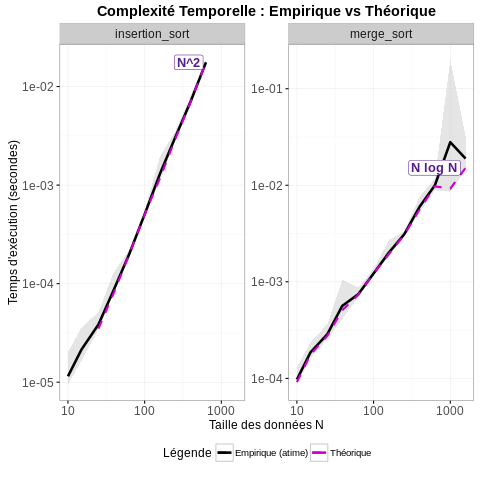

# Sorting complexity in R

Measuring the real running time of insertion sort and merge sort in R, using the [`atime`](https://github.com/tdhock/atime) package to benchmark them on inputs of increasing size.

Version française plus bas.



## What's inside

- `Code.R`: both sorting algorithms written in R, the `atime` benchmark, and the plot.
- `complexity_with_R.png`: the resulting graph.

## Run it

In R:

```r
install.packages(c("atime", "animint2"))
source("Code.R")
```

## What I learned

Counting instructions (see [sorting-complexity-python](https://github.com/oberlinkeyanfe-ops/sorting-complexity-python)) gives the theory. Measuring time with `atime` shows the same thing in practice: insertion sort follows a quadratic curve, merge sort follows n log n, and the gap widens quickly as the input grows.

---

## Version française

Mesure du temps d'exécution réel du tri par insertion et du tri fusion en R, avec le package `atime`. Le fichier `Code.R` contient les deux algorithmes et le benchmark ; le graphique obtenu est `complexity_with_R.png`.

Pour lancer : installer `atime` et `animint2`, puis exécuter `source("Code.R")` dans R.
